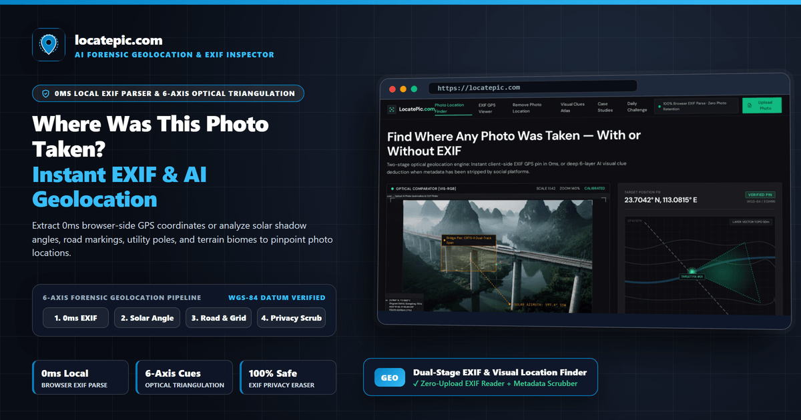
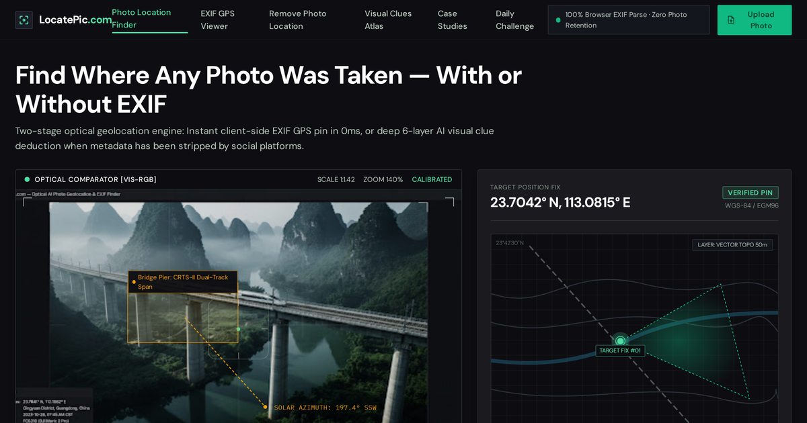

[](https://mcptry.com/servers/com.locatepic/mcp)

[](https://locatepic.com)

Official stateless **Model Context Protocol (MCP)** server and Agent Skill for **[LocatePic (locatepic.com)](https://locatepic.com)**.

- **Official Website**: [https://locatepic.com](https://locatepic.com)
- **Streamable HTTP MCP Endpoint**: `https://locatepic.com/api/mcp` (Public read-only tools, zero API key required)
- **Official MCP Registry ID**: `com.locatepic/mcp` (Domain-verified via Ed25519)
- **License**: MIT

---

## ⚡ Quick Connect (Claude Desktop / Cursor / Windsurf / Grok / Hermes)

Add the remote Streamable HTTP endpoint directly to your MCP configuration:

```json
{
  "mcpServers": {
    "locatepic": {
      "type": "http",
      "url": "https://locatepic.com/api/mcp"
    }
  }
}
```

### Install Agent Skill (`skills.sh` / Claude Code / Cursor)

```bash
npx skills add AbigailDavised/locatepic-mcp
```

---

## 🖼️ Interactive Web Workbench Preview

[](https://locatepic.com)

## 🔗 Key Capabilities & Direct Web Tools

- **[LocatePic Photo Location & EXIF Inspector](https://locatepic.com)**: https://locatepic.com
- **[Solar Shadow Latitude Calculator](https://locatepic.com/solar-shadow-calculator)**: https://locatepic.com/solar-shadow-calculator
- **[Visual Geolocation Clues Directory](https://locatepic.com/clues)**: https://locatepic.com/clues
- **[Driving Side & Road Markings by Country](https://locatepic.com/clues/driving-side-by-country)**: https://locatepic.com/clues/driving-side-by-country
- **[International Phone Dialing Clues](https://locatepic.com/clues/phone-calling-codes)**: https://locatepic.com/clues/phone-calling-codes
- **[Multi-Point Route Trace Analyzer](https://locatepic.com/route-trace)**: https://locatepic.com/route-trace

---

## 🧪 Live JSON-RPC 2.0 Verification

```bash
curl -s -X POST https://locatepic.com/api/mcp \
  -H "Content-Type: application/json" \
  -d '{"jsonrpc":"2.0","id":1,"method":"tools/call","params":{"name":"calculate_solar_shadow_latitude","arguments":{"objectHeightMeters":2.0,"shadowLengthMeters":1.73,"month":3}}}'
```
